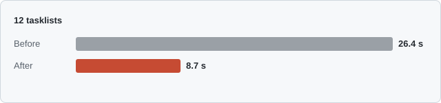

  

This is an advanced fork of the latest [Abstractspoon ToDoList](https://github.com/abstractspoon/ToDoList_Dev) application for _Windows_.

But why? Well, the original app focuses on a specific working style that has influenced its development direction, especially in recent years. Some decisions have been made that don't work for everyone, and the user has been given no way to choose what's best for them. The new attribute editor in v9 is a good example. It's based on the idea of a _property grid_, which is great for complex applications with tons of properties. But if you only need to edit a few properties, this thing is a big waste of screen space — especially when you're working with a split view that is evenly shared between the task list and the comments editor. _Better TDL_ gives you the option to switch back to the classic attribute editor approach.

But _Better TDL_ doesn't stop there. It also focuses on issues that haven't been addressed for decades, like performance and user experience. You can read more about that in the features list.

So in the end, _Better TDL_ is just what the name implies. And everything that worked before, including your extensions, still works as expected.

## Features

### 1. Your whole workspace in one Home Folder

Point Better TDL at a folder and get a browser-style tree of everything in it. `.tdl` files open as tasklists, other files open in their default application, and open lists are marked as such.

- Open a folder, a multi-selection or a tasklist set (`*.tdlset.txt`) in one action; **Open & Replace** swaps the current documents for them.
- Sets are plain text, can overlap, and group tasklists in a fixed order.
- The Home Folder is stored per machine, so a shared `ToDoList.ini` still works on different PCs.

### 2. Startup that scales far better with your session

Every tasklist beyond the active one used to cost about 1.5 seconds to prepare. Now background tabs create their window only when first opened, and the throwaway "untitled" list is gone.

  

- Restored, menu-opened and Home-opened tasklists load the first document fully and defer the rest.
- Twelve open tasklists now start in about a third of the time.

### 3. The classic attribute editor is back

The v8.2 horizontal attribute bar returns as an opt-in alternative to the 9.x property grid: only the fields you actually use, and no wasted space.

- Enable it under **Preferences → UI → "Use legacy attribute editor (v8.2 style)"**.
- Works with built-in and custom attributes, including time-tracking and dependency controls.

### 4. Switch tasklists the way you think

Hold **Ctrl+Tab** for an IDE-style most-recently-used switcher.

- The previous tasklist is preselected; **Tab**/**Shift+Tab** move, **Enter** accepts, **Esc** cancels.
- Unsaved tasklists are highlighted, unloaded ones are greyed out.

### 5. Quick Find shows you the match

When Quick Find picks a task because the term is in its comments, the matching text is highlighted in the comments editor.

- Works while typing and with Quick Find Next/Previous, including quoted phrases.

### 6. A comments editor that keeps your structure

- **Enter** keeps the current paragraph's indentation.
- Wrapped lines align under the text after the indent, including `- `, `-> ` and `=> ` bullet prefixes.
- **Shift+Tab** outdents every selected line.

### 7. Preferences you can actually search

- Search as you type and jump to matching pages.
- Selecting a section highlights the whole group.
- Nearly every setting has a tooltip taken from the wiki.

### 8. Your tree stays the way you left it

Clearing a filter now restores the expansion state you had before it was applied.

### 9. Undo and redo that tell you what they will do

The menu, toolbar and their tooltips name the action that will be undone or redone, and the modified marker clears when you return to the saved state.

### 10. Several other fixes, improvements and legacy options

Too many to list, and none of them need a paragraph.

## Building from source

See [docs/BUILDING.md](docs/BUILDING.md) for the required tools and how to run the build,
test, clean and packaging scripts in the repository root.
